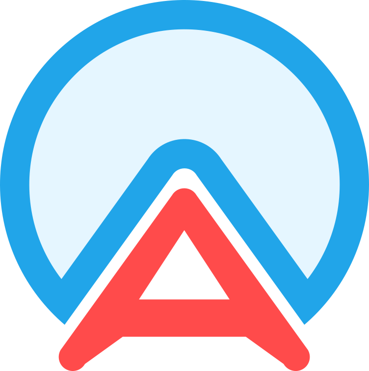
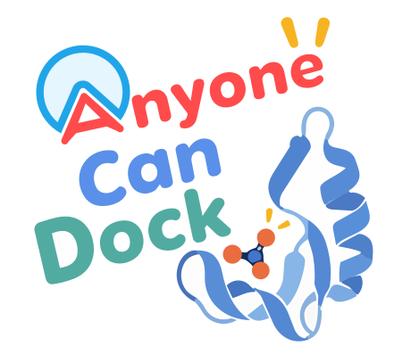

#  nyone can dock, everyone can do!

***One molecular docking workflow, four ways to run.***

[](https://nyelidl.github.io/anyone-docking/)
[](https://pypi.org/project/anyonecandock/)
[](LICENSE)

Anyone Can Dock (ACD) combines receptor and ligand preparation, molecular docking, pose visualization, and interaction analysis. Choose a **browser app**, a **local graphical interface**, an **automation-friendly CLI**, or a **Google Colab notebook with additional docking engines**.

> From structure preparation to pose analysis, with fewer setup steps.

📘 **[Interactive tutorial and hands-on exercises →](https://nyelidl.github.io/Docking_workshop/#en/intro)**  
📢 **[Follow ACD on Facebook →](https://www.facebook.com/anyonecandock/)**

---

## 🚀 Four ways to use Anyone Can Dock

| Feature | 🌐 Online | 🖥️ Local | ⌨️ CLI | 📓 Google Colab notebook |
|---|---|---|---|---|
| Best for | Quick docking and teaching | Interactive research on your computer | Scripts, servers, and screening | Workshops and additional engines |
| Setup | Open a browser | Install and launch Streamlit | `python -m pip install anyonecandock` | Open and execute the notebook |
| Single and batch docking | ✅ | ✅ | ✅ | ✅ |
| Co-Dock: ligands together | ✅ | ✅ | ✅ | ✅ |
| Co-crystal redocking | ✅ | ✅ | ✅ | ✅ |
| Flexible receptor side chains | Vina only | Vina only | Vina only; CLI 1.4.1 | Vina only |
| Receptor-ensemble docking | — | — | ✅ | — |
| Docking engines | Vina 1.2.7 | Vina 1.2.7 | Vina 1.2.7, VinaXB, GNINA¹ | Vina 1.2.7, VinaXB, GNINA, Vina-GPU 2.1 |
| Results | Interactive 3D, 2D diagrams, tables, downloads | Interactive 3D, 2D diagrams, tables, downloads | Structure files, tables, diagrams, logs | Notebook 3D views, ProLIF analysis, downloads |
| Automated Gemini interpretation | — | — | — | Optional; requires configuration |
| Where docking runs | Hosted server | Your computer | Your computer or server | Colab runtime |
| Start here | [Open Online →](https://nyelidl.github.io/anyone-docking/) | [Local installation](#-acd-local) | [CLI installation](#-acd-cli) | [Open notebook →](https://colab.research.google.com/drive/1tApXZyT3CGziMTLG86oQe6Q7WSycK196?usp=sharing) |

¹ CLI engine downloads depend on the operating system. **Co-Dock and flexible receptor docking use Vina only.** GNINA's managed binary requires Linux x86-64; VinaXB has no native Apple Silicon binary. Engine binaries download on first use on supported platforms; they are not bundled in the Python wheel.

**Release note:** the latest PyPI release checked on November 5, 2026 is **1.4.0**. CLI flexible docking is included in the **1.4.1 source/release package** and requires that version; it is not yet available through the published 1.4.0 package. The table describes the updated project sources; deployed apps and saved Colab copies may need updating.

**Prefer a web interface running on Colab?** Use the separate launcher:  
[](https://colab.research.google.com/drive/1WtWYUUB1AREZMeB5qEJ9OD84AvWk1z4z?usp=sharing)

---

## 🌐 ACD Online

**Best for:** beginners, teaching, demonstrations, and quick docking without local installation.

### Prepare once, then choose a docking mode

1. Enter a **PDB ID** or upload a **PDB/mmCIF** structure.
2. Select the reference ligand or another supported method to define the docking box. Review chains, retained cofactors, and box dimensions.
3. Optionally enable **Flexible docking: receptor flexibility — optional** and select side chains.
4. Click **Prepare Receptor** and inspect the 3D receptor and docking box.
5. Choose **Single Dock**, **Batch Dock**, **Co-Dock**, or **Redock**. The modes reuse the prepared receptor and box.

Changing the receptor, reference ligand, box, or flexible-residue selection requires preparing the receptor again.

| Mode | What it does |
|---|---|
| **Single Dock** | Dock one ligand against the receptor. |
| **Batch Dock** | Dock each ligand independently, then compare scores and interactions. |
| **Co-Dock: dock ligands together** | Dock 2–4 ligands together in one joint Vina search. |
| **Redock** | Re-dock a selected co-crystal ligand and compare its predicted pose with the crystal coordinates. |

### Ligand input

For **Batch Dock**, the input choices are:

**SMILES list (text) · Compound name · Upload .smi file · Upload structure files (.pdb/.mol2)**

- **SMILES list:** enter one `SMILES name` per line. The editable area is 300 px tall.
- **Compound name:** enter one name and click **Search**. Review the returned PubChem structure and information; the SMILES is added to the editable list. Repeat to build the batch.
- **Upload .smi file:** use the same one-compound-per-line format.
- **Upload structure files:** supply the supported file types shown in the interface.

For **Co-Dock**, the same choices are available with **Compound name first**. Add 2–4 ligands for one joint docking run.

```text
CCO ethanol
c1ccccc1O phenol
```

**Co-Dock is not a combination generator:** aspirin + baicalein produces joint poses containing both ligands. It does not automatically enumerate aspirin + aspirin, baicalein + baicalein, or all possible subsets. Scores describe the joint docking solution, rather than separate affinities for each component.

### Preparation and results

- Meeko receptor preparation, with Open Babel fallback where applicable
- pH-aware and tautomer-aware ligand preparation with pKaNET
- Automatic reference-ligand, manual XYZ, ProDy-selection, and blind-docking boxes
- Metal, heme, cofactor, water, and other HETATM handling
- Configurable exhaustiveness, pose count, energy range, and random seed
- 3D pose animation, interactive pose selection, and binding-pocket views
- ACD, RDKit, ProLIF, and PoseView interaction analysis, depending on the workflow
- Batch ranking, interaction barcodes/profiles, and result archives
- Individual pose exports, score CSVs, receptor files, and PDBQT outputs
- RDKit descriptors, drug-likeness rules, structural alerts, and optional ADMET-AI predictions

For heavy usage, use [Google Colab](https://colab.research.google.com/drive/1tApXZyT3CGziMTLG86oQe6Q7WSycK196?usp=sharing), Local, or CLI.

---

## 🖥️ ACD Local

**Best for:** interactive docking with compute and result storage on your computer.

Local includes the shared receptor preparation panel, Single Dock, Batch Dock, Co-Dock, Redock, optional flexible side chains, 3D/2D analysis, and result downloads. The Colab web launcher uses `app-colab.py`.

Docking runs locally, but optional services can still send or retrieve data over the internet: RCSB downloads, PubChem searches, PoseView diagrams, and first-use engine downloads. Review these options before using confidential structures.

### Linux: Ubuntu/Debian

Install Python 3.11 and its virtual-environment package from a source appropriate for your Linux distribution, then install the system dependencies:

```bash
sudo apt update
sudo apt install -y openbabel libcairo2-dev libpango1.0-dev libpangocairo-1.0-0

git clone https://github.com/nyelidl/anyone-docking-local.git
cd anyone-docking-local

python3.11 -m venv venv
source venv/bin/activate
python -m pip install --upgrade pip
python -m pip install -r requirements.txt

streamlit run app.py
```

### macOS

```bash
brew install python@3.11 open-babel cairo pango

git clone https://github.com/nyelidl/anyone-docking-local.git
cd anyone-docking-local

python3.11 -m venv venv
source venv/bin/activate
python -m pip install --upgrade pip
python -m pip install -r requirements.txt

streamlit run app.py
```

Vina supports Apple Silicon through a native `aarch64` binary. Availability of other engines differs by platform.

### Windows

**Recommended:** use WSL2 with Ubuntu and follow the Linux workflow.

For native Windows, install Python 3.10+ and Open Babel, add Open Babel to `PATH`, and provide Cairo/Pango if required by diagram export. Then:

```powershell
git clone https://github.com/nyelidl/anyone-docking-local.git
cd anyone-docking-local
python -m venv venv
.\venv\Scripts\Activate.ps1
python -m pip install --upgrade pip
python -m pip install -r requirements.txt
streamlit run app.py
```

---

## 🦾 Flexible docking: selected receptor side chains

Flexible docking allows **selected receptor side chains and the ligand to move during Vina docking**. The protein backbone and unselected receptor atoms remain fixed. It is not whole-protein flexibility or molecular dynamics.

### Online and Local

1. Enable **Allow selected protein side chains to move**.
2. Select residues by **chain and residue number**. Yellow tags correspond to yellow sticks in the 3D view.
3. Click **Prepare Receptor**. The app checks the prepared flexible files against your selection.
4. Confirm **Flexible docking ready**, then run Single Dock, Batch Dock, or Co-Dock.
5. Inspect the selected pose's saved receptor conformation in the result viewers. A completed flexible single-docking run shows **Docking complete · Flexible docking**.

- **Disabled:** rigid receptor docking.
- **Enabled with no selection:** preparation stops and asks for residues.
- **Selection/prepared-file mismatch:** docking is blocked until the receptor is prepared again.
- **Online limit:** up to three selected flexible residues. Local and CLI do not impose that same fixed cap.
- Missing side-chain atoms, alternative locations, disulfide cysteines, and metal-coordinating selected side chains can prevent flexible preparation.

The updated Online/Local animation pairs each ligand pose with its saved receptor frame. The pose selector and pocket view use the matching receptor, with selected flexible residues highlighted yellow. A similar rotamer across poses can be a valid result; visible movement is not guaranteed.

Flexible outputs include the original combined Vina PDBQT, ligand-only outputs, pose-specific receptor/complex PDBs, and a provenance manifest. These files require further preparation before MD simulations.

---

## ⌨️ ACD CLI

**Best for:** automation, reproducible scripts, servers, batch screening, redocking, and receptor ensembles.

### Install

Use **Python 3.10 or newer**; Python 3.11 is a practical choice. Open Babel and relevant system libraries must be installed separately.

```bash
python -m pip install --upgrade anyonecandock
acd --version
acd --help
```

Installing the Python package does not install CUDA, OpenCL drivers, or every scientific system dependency. Vina, VinaXB, and GNINA are downloaded on first use on supported platforms. **Vina-GPU is not included in the current standard CLI release**; it remains available through the Colab workflow.

### Commands

```text
acd <command> [options]

  dock      Prepare and dock one ligand
  redock    Re-dock a selected co-crystal ligand and calculate RMSD
  batch     Dock ligands independently against one receptor
  codock    Dock multiple ligands together in one joint Vina search
  ensemble  Dock a ligand library against multiple receptor conformations
  receptor  Prepare a receptor and save reusable preparation metadata
  ligand    Prepare a ligand without docking
  diagram   Generate a 2D interaction diagram
```

### Quick examples

```bash
# Dock by PubChem compound name
acd dock --receptor 1M17 --compound erlotinib --ph 7.4 --output ./erlotinib_dock

# Dock a local ligand file
acd dock --receptor structure.cif --ligand-file ligand.sdf --name mylig

# Validate a setup by co-crystal redocking
acd redock --receptor 4AGN

# Prepare a receptor once and reuse it
acd receptor --pdb 1M17 --output ./rec_1m17
acd dock --receptor-json ./rec_1m17/receptor_summary.json --compound erlotinib

# Batch docking: one SMILES [name] per line in compounds.smi
acd batch --receptor 1M17 --ligands compounds.smi

# Choose an engine: Vina is the default when -e/--engine is omitted
acd dock --receptor 1M17 --compound erlotinib -e vina
acd dock --receptor 1M17 --compound erlotinib -e vinaxb
acd dock --receptor 1M17 --compound erlotinib -e gnina

# Dock against multiple receptor conformations
acd ensemble --receptors "ensemble/*.pdb" --ligands compounds.smi --seed 42
```

### Co-Dock: one ligand option, several input formats

Use `--ligand` for compound names, inline SMILES, structure files, a `.smi` file, or a mixture. Quote names containing spaces and quote each inline `SMILES name` entry.

```bash
# Compound names: resolved through PubChem
acd codock --receptor 1M17 --ligand aspirin baicalein

# Inline SMILES with labels
acd codock --receptor 1M17 --ligand "CCO ethanol" "c1ccccc1O phenol"

# Structure files
acd codock --receptor protein.pdb --ligand ligand1.sdf ligand2.pdbqt

# A .smi file containing at least two ligands
acd codock --receptor 1M17 --ligand pair.smi

# Mix input types
acd codock --receptor 1M17 --ligand "CCO ethanol" aspirin ligand3.sdf
```

These are input-format examples, not claims that the compounds bind the selected target.

### Flexible docking: CLI 1.4.1

Requires the 1.4.1 source/release package until that version is published to PyPI:

```bash
acd dock --receptor 1M17 --compound erlotinib \
  --engine vina --flex-residues "A:702,A:764" --save-poses
```

Use residue identifiers present in your structure and review the binding pocket before selecting them. `--flex-residues` is also available for receptor preparation, batch, Co-Dock, redock, and ensemble workflows. Unsupported engines reject flexible inputs.

### Receptor ensembles

`ensemble` accepts receptor files, directories, quoted glob patterns, or PDB IDs. Every receptor is prepared independently; failed preparations are recorded without silently bypassing validation. A shared manual box requires receptors aligned in the same coordinate frame.

Typical summary outputs are:

```text
ensemble_screen/
  001_model1/
  002_model2/
  ensemble_receptors.csv
  ensemble_scores.csv
  ensemble_summary.csv
```

Summary statistics are ranking aids, not population-weighted binding free energies.

### Redocking RMSD

ACD compares the re-docked ligand with its crystal coordinates using heavy-atom RMSD:

- **PASS:** ≤2.0 Å
- **BORDERLINE:** >2.0 to 3.0 Å
- **FAIL:** >3.0 Å

These are pose-recovery thresholds, not proof of experimental affinity or general validity for every ligand.

For complete options, use `acd <command> --help`. Python workflows can also use `from anyonecandock import core`.

---

## 📓 ACD Google Colab

**Best for:** workshops, education, portable research, and compatible GPU docking without local installation.

[](https://colab.research.google.com/drive/1tApXZyT3CGziMTLG86oQe6Q7WSycK196?usp=sharing)

### Notebook workflow

0. Run **Install Conda Colab**, **Install Dependencies and Docking Engines**, and **Import Modules & Verify Tools**. Follow any runtime-restart instructions.
1. Download or upload the receptor, choose the pocket, and prepare the receptor and ligands.
2. Select an engine and run docking.
3. Inspect scores, poses, RMSD, and interaction analysis.
4. Optionally run the configured Gemini interpretation and download the results.

### Features

- **Four engines:** Vina 1.2.7, VinaXB, GNINA, and Vina-GPU 2.1
- Vina-GPU setup occurs on first use in the docking step and is reused within the same runtime
- Optional Vina receptor side-chain flexibility, configured during receptor preparation
- Co-crystal redocking, batch docking, and joint Co-Dock
- **1–10 iterative runs:** one run by default; repeated-run analysis uses each ligand's top-pose score per run in box plots
- 3D pose inspection, heavy-atom RMSD analysis, and engine-aware score extraction
- ProLIF interaction analysis, ranked CSVs, selected-pose exports, and ZIP downloads
- Optional **automatic Gemini interpretation** when enabled and configured; API access/credentials may be required

Gemini summarizes the computed outputs; it does not perform the docking or establish experimental binding. The notebook's latest viewer behavior can differ from the separate Colab-hosted web interface. GPU and engine availability depend on the allocated Colab runtime.

---

## 🧬 Heme, metals, and receptor limitations

ACD includes preparation checks for supported ferric-heme and Compound-I centers, including geometry-based ferryl oxygen/proximal cysteine identification, Fe–O/Fe–S distance checks, removal of inappropriate ferryl O–H hydrogen, JSON-derived RESP charges, and final PDBQT validation. Required checks must pass before a supported heme workflow proceeds.

Common metal ions and selected cofactors can be retained during preparation. This does **not** imply that standard Vina uses a full metal coordination force field, 12-6-4 polarization potential, or a reactive heme model. Inspect coordination, protonation, oxidation state, and retained cofactors for your system.

| Structure or workflow | Practical guidance |
|---|---|
| Single- or multi-chain proteins | Supported; check that the required chains are retained. |
| Multiple bound ligands | Select the intended reference ligand and pocket. |
| Missing residues/atoms | Inspect pocket completeness and rebuild problematic regions where necessary. |
| Modified residues or unusual cofactors | Preparation depends on available templates and atom typing; inspect the logs. |
| MD-derived receptor snapshots | Use suitable PDB snapshots; align them before applying a shared manual box. |
| RNA/DNA targets | No dedicated nucleic-acid preparation or interaction model is claimed. |
| Covalent docking | Not provided by the standard non-covalent workflow. |

---

## 🗺️ Understanding results

- **Docking affinity (kcal/mol):** a scoring-function estimate. More negative Vina scores are generally more favorable within a comparable setup.
- **RMSD (Å):** a coordinate difference whose meaning depends on the reference. RMSD versus the crystal ligand measures pose recovery; Vina's reported lower/upper bounds compare against its best pose.
- **Predicted pose:** a candidate binding arrangement, not an experimentally observed complex.
- **Interactions:** geometry-based contacts or tool-specific assignments. A close contact alone is not proof of a hydrogen bond.
- **Flexible poses:** inspect the matching receptor/complex file; do not combine the ligand with an unrelated starting receptor.
- **Co-Dock:** the score belongs to the joint ligand configuration; it is not an individual affinity for each ligand.

Depending on the interface, diagrams use ACD, RDKit, ProLIF, or PoseView. ACD's geometric analysis includes hydrogen bonds, hydrophobic, aromatic, cation–π, ionic, metal/heme, halogen, and H···halogen contact categories.

**Scientific caution:** docking scores do not prove experimental binding affinity, inhibition, selectivity, or biological activity. Scores from different engines or preparation protocols should not be treated as directly interchangeable.

---

## 🤖 Optional AI interfaces

AI interfaces orchestrate the existing ACD backend; they are not separate docking engines.

### Anyone Can Dock GPT

[Open Anyone Can Dock GPT →](https://chatgpt.com/g/g-6a0455faa96481918503be2b696e13ce-anyone-can-dock-gpt)

[Watch the docking walkthrough →](https://youtu.be/nic3YhyMyTE)

### MCP clients

Compatible clients, including configured ChatGPT and Claude connections, can use the same ACD MCP service:

```text
https://anyone-can-dock-mcp.anyonecandock.workers.dev/mcp
```

Availability depends on the client's account, connector permissions, and supported features. Connecting an MCP server does not automatically make a plugin publicly searchable.

Example request:

```text
Dock erlotinib against PDB 1M17 at pH 7.4 using the co-crystal ligand to define the pocket.
```

The workflow should resolve the compound through PubChem, scan the actual receptor's bound ligands, select an exact returned reference-ligand key, submit a docking job, and retrieve its status/results. Do not invent ligand keys, structures, scores, contacts, or box coordinates.

---

## 📄 Citation

Cite ACD and the methods actually used in your workflow:

- **Anyone Can Dock: An Online Molecular Docking Tool for Everyone.** Hengphasatporn, K.; Bunchuay, T.; Duan, L.; Shigeta, Y. *Journal of Cheminformatics*, 2026. [DOI: 10.1186/s13321-026-01306-2](https://doi.org/10.1186/s13321-026-01306-2)
- **AutoDock Vina 1.2.0: New Docking Methods, Expanded Force Field, and Python Bindings.** Eberhardt et al. *Journal of Chemical Information and Modeling*, 2021. [DOI: 10.1021/acs.jcim.1c00203](https://doi.org/10.1021/acs.jcim.1c00203)
- **DFDD.** Hengphasatporn, K.; Duan, L.; Harada, R.; Shigeta, Y. *Journal of Chemical Information and Modeling*, 2026. [DOI: 10.1021/acs.jcim.5c02852](https://doi.org/10.1021/acs.jcim.5c02852)
- **RDKit:** [rdkit.org](https://www.rdkit.org/)
- **ProDy:** Bakan et al. *Bioinformatics*, 2011. [DOI: 10.1093/bioinformatics/btr168](https://doi.org/10.1093/bioinformatics/btr168)
- **stmol:** Nápoles-Duarte et al. *Frontiers in Molecular Biosciences*, 2022. [DOI: 10.3389/fmolb.2022.990846](https://doi.org/10.3389/fmolb.2022.990846)
- **Dimorphite-DL:** Ropp et al. *Journal of Cheminformatics*, 2019. [DOI: 10.1186/s13321-019-0336-9](https://doi.org/10.1186/s13321-019-0336-9)
- **Gemmi:** Wojdyr, M. *Journal of Open Source Software*, 2022. [DOI: 10.21105/joss.04200](https://doi.org/10.21105/joss.04200)
- **pKaNET Cloud:** cite the corresponding manuscript when available.

When using VinaXB, GNINA, Vina-GPU, Meeko, ProLIF, or PoseView, also cite the relevant software/method publication.

---

## 📜 License and support

ACD is distributed under the **MIT License**; see [LICENSE](LICENSE). Third-party engines and dependencies retain their own licenses.

- [Report an issue →](https://github.com/nyelidl/anyone-docking/issues)
- [Follow ACD on Facebook →](https://www.facebook.com/anyonecandock/)

<div align="center">
  
</div>
****
